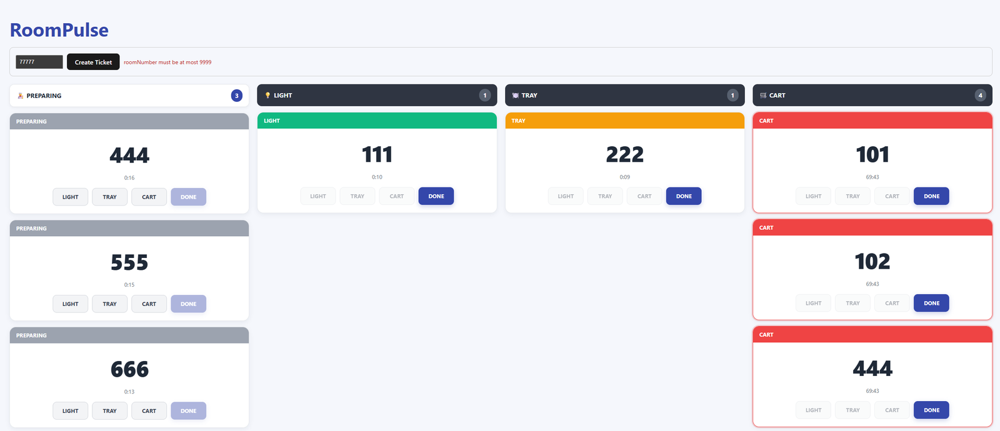
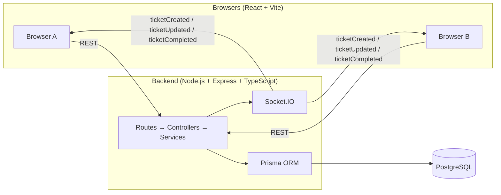
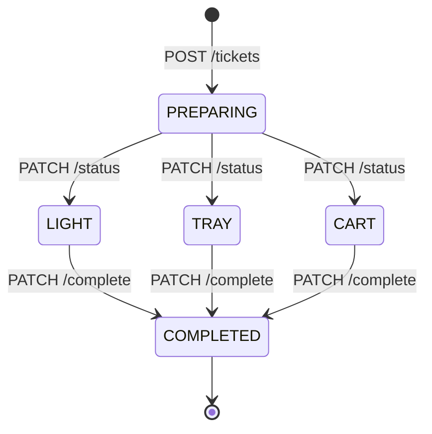
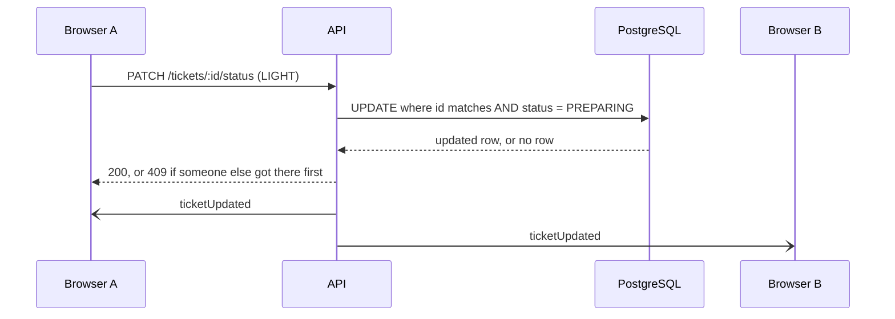

# RoomPulse

Real-time tracking of room service orders for hotels. Every order is a *ticket* that moves through a fixed lifecycle, and every connected device sees the changes instantly, with timers that stay in sync even if the devices' clocks are different.



**Live demo:** coming soon

> Personal portfolio project. It is not affiliated with any commercial product that shares its name.

## Features

- Create service tickets by room number.
- Live board: tickets appear, move and disappear on every open device without reloading.
- Delivery flow enforced by the **server**, not by the UI: `PREPARING → LIGHT | TRAY | CART → COMPLETED`.
- Elapsed-time timers with color alerts, calculated on the **server's clock**.
- The board recovers on its own after a lost connection, and shows clear errors.

### Delivery types

Each order is delivered in one of three ways, so the staff can anticipate what kind of pickup each room will need:

- **LIGHT**: a light order, carried by hand on a small tray.
- **TRAY**: a large tray with several items.
- **CART**: a service cart that is left in the room.

## Architecture



### Ticket lifecycle



### What happens when a device changes a ticket



## Design decisions

- **The server owns the rules.** Valid transitions are checked in the API, so no client (or direct API call) can skip steps, complete a ticket twice or change a delivery type after the fact.
- **Atomic transitions.** Each transition is a single `UPDATE` that includes the expected current state in its `WHERE` clause. If several devices act on the same ticket at the same moment, the database lets exactly one through and the rest get `409 Conflict`. This is covered by an integration test that fires ten simultaneous requests.
- **No stale screens.** The client reloads the real state after a reconnection and after any failed action. Real-time events are applied idempotently, so a late or duplicated event never creates duplicate tickets.
- **One clock for everyone.** Clients measure their offset from the server's clock and use it for all timers, so every device shows the same elapsed time and the same alert colors.
- **Validated configuration.** Environment variables are validated at startup (Zod). A wrong or missing value stops the app with a readable message instead of failing later. CORS is restricted to the configured origins, for both REST and WebSockets.
- **Uniform errors.** Every error returns `{ "error": { "code", "message", "details?" } }` with the right status code (400, 404, 409, 500).
- **Tests use their own database.** The suite creates and migrates a separate `roompulse_test` database and refuses to run against any database whose name does not end in `_test`.

## API

| Method | Endpoint | Description | Responses |
|---|---|---|---|
| `POST` | `/tickets` | Create a ticket. Body: `{ "roomNumber": 1-9999 }` | `201`, `400` |
| `GET` | `/tickets/active` | Tickets that are not completed, oldest first | `200` |
| `PATCH` | `/tickets/:id/status` | Deliver a ticket. Body: `{ "status": "LIGHT" \| "TRAY" \| "CART" }` | `200`, `400`, `404`, `409` |
| `PATCH` | `/tickets/:id/complete` | Complete a delivered ticket | `200`, `404`, `409` |
| `GET` | `/time` | Server time, used to align the clients' clocks | `200` |

Error example:

```json
{
  "error": {
    "code": "CONFLICT",
    "message": "Only tickets in PREPARING can be delivered (current status: LIGHT)"
  }
}
```

### Socket.IO events (server → clients)

| Event | Payload | When |
|---|---|---|
| `ticketCreated` | the ticket | A ticket was created |
| `ticketUpdated` | the ticket | A ticket was delivered |
| `ticketCompleted` | the ticket | A ticket was completed |

## Tech stack

- **Backend:** Node.js, Express 5, TypeScript, Prisma 7, PostgreSQL 15, Socket.IO, Zod
- **Frontend:** React, Vite, TypeScript, socket.io-client
- **Tests:** Vitest, Supertest
- **Tooling:** npm workspaces, Docker Compose

## Run it locally

Requirements: Node.js 20+ and Docker.

```bash
git clone https://github.com/AdalbVP/RoomPulse.git
cd RoomPulse
npm install

# 1. Database
docker compose up -d

# 2. Backend configuration (the defaults match docker-compose.yml)
cp apps/backend/.env.example apps/backend/.env

# 3. Prisma client and migrations
cd apps/backend
npx prisma generate
npx prisma migrate deploy

# 4. Start the API on http://localhost:3000
npm run dev
```

In a second terminal:

```bash
cd apps/frontend
npm run dev    # http://localhost:5173
```

Open the app in two browser tabs to see the real-time sync. If the API runs somewhere else, copy `apps/frontend/.env.example` to `apps/frontend/.env` and change `VITE_API_URL`.

### Environment variables (backend)

| Variable | Description | Default |
|---|---|---|
| `DATABASE_URL` | PostgreSQL connection string | required |
| `PORT` | Port the API listens on | `3000` |
| `NODE_ENV` | `development`, `production` or `test` | `development` |
| `CORS_ORIGIN` | Allowed origins, comma separated. Required in production | any origin (development only) |

## Tests

```bash
cd apps/backend
npm test
```

Needs the Postgres container running. The first run creates the `roompulse_test` database and applies the migrations by itself. The suite has 23 integration tests covering validation, error handling, every state transition, the real-time events and the concurrent-requests case.

## Project structure

```
apps/
├── backend/
│   ├── prisma/          schema and migrations
│   ├── src/
│   │   ├── routes/      endpoints
│   │   ├── controllers/ request validation, response, socket events
│   │   ├── services/    business rules and database access
│   │   ├── schemas/     Zod validation schemas
│   │   ├── middlewares/ centralized error handling
│   │   ├── errors/      typed errors (404, 409...)
│   │   ├── sockets/     Socket.IO setup
│   │   ├── config.ts    validated environment variables
│   │   └── app.ts       Express app (server.ts only opens the port)
│   └── test/            integration tests
└── frontend/
    └── src/
        ├── components/  board cards and ticket form
        ├── hooks/       useTickets: state, real-time events, resync
        └── services/    API client and socket connection
```

## Roadmap

- Authentication and roles (for example reception vs. service staff).
- Public live demo.
- Shared package for the types used by the backend and the frontend.
